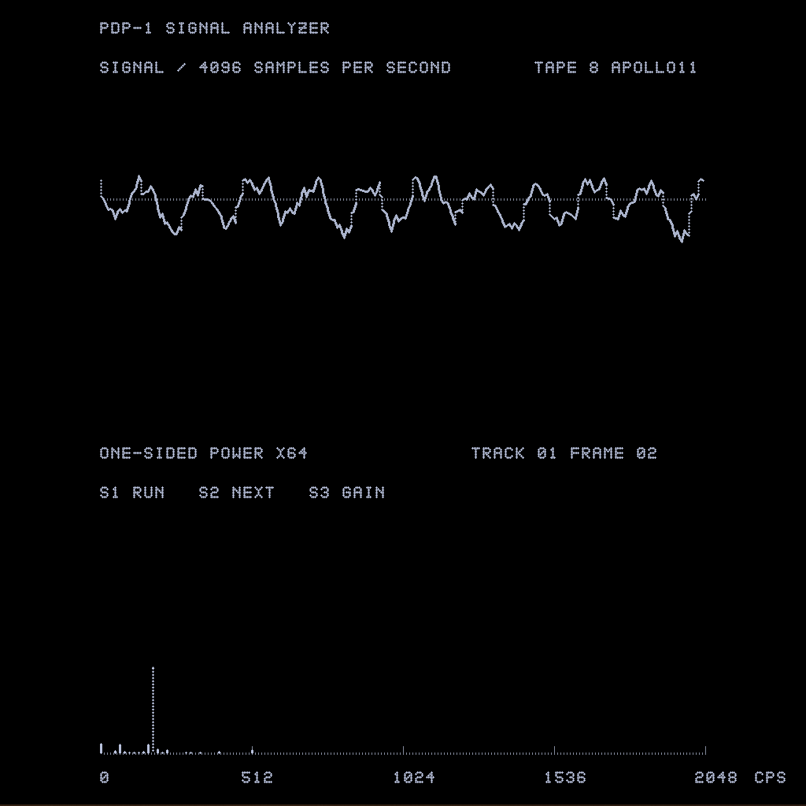

# Signal Analysis Workstation for PiDP-1

A signal-analysis workstation that runs a **256-point fixed-point FFT on the emulated PDP-1** and draws the waveform and power spectrum with a Type 340 display. Recordings come from a Type 23 drum image or named files on a Type 550 Microtape.

Created by **Phillip Porch** for the PiDP-1, using [wjenh/pidp1-mods](https://github.com/wjenh/pidp1-mods). The current preview is **v4**, with read-only Microtape loading.



The PDP-1 performs the FFT and power calculation. Host tools prepare sample recordings, manage image files and load the assembled program. Analysis is slower than the recording's original playback duration; the station does not play audio or capture live sound.

## Features

- Connected waveform and one-sided power spectrum, from DC through 2048 CPS.
- Hold, continuous analysis and single-frame stepping through the sense switches.
- X4/X64 spectrum display gain for strong and quiet recordings.
- Interrupt-driven display refresh with BBN millisecond-clock measurements.
- Checksummed Type 23 drum acquisition with bounded DMA requests.
- Named Microtape recordings, loaded read-only into extended RAM before analysis.
- WAV preparation with channel selection, anti-alias resampling and explicit gain.
- Preassembled programs, complete station source, sample media and optional development tests.

| Analysis setting | Value |
|---|---:|
| Sample rate | 4096 samples/second |
| Samples per FFT | 256 |
| Recording time per frame | 62.5 ms |
| Frequency spacing | 16 CPS/bin |
| Input | Signed 18-bit one's-complement samples |
| Spectrum | DC–2048 CPS |
| Drum recording limit | 31 seconds |
| Microtape RAM loading limit | 11 logical seconds |

## Requirements

Use an existing compatible **pidp1-mods** installation. This repository does not install or reconfigure the emulator itself.

The v4 build was tested with pidp1-mods revision [`a81ef4b`](https://github.com/wjenh/pidp1-mods/commit/a81ef4b99786ff04624ae8529c2bc6b826f767c1), AM1 5.7, AD1 2.9 and the filesystem/Microtape 2.1 includes.

- A Linux Pi with Python 3 and **64K words of emulated core**.
- Hardware multiply/divide enabled.
- Type 340 display and Type 342 character support, with the display viewer open.
- BBN clock at IOT 032 and sequence-break support.
- Type 23 drum support for drum mode; Type 550 Microtape support and `bin/mtfs` for tape mode.
- `core1D` or `all1D` enabled for the filesystem library. The numerical kernel itself retains its original-instruction-set implementation.
- Local command port **1040**, compatible AD1 debugger port **1044**, and the installed AM1-aware `bin/fastload`.

AM1 and the installed include files are required to rebuild or change the selected tape recording. FFmpeg and ffprobe are needed only to import another WAV. A compatible newer emulator revision may work but has not been established by the original validation.

## Install and check

Signal Station is included in this checkout under `FunStuff/SignalAnalysis`. From the installed pidp1-mods directory:

```sh
cd FunStuff/SignalAnalysis
make check
```

Keep the directory name **SignalAnalysis** under `FunStuff`; the loader and supplied relative tape path use that layout. The standalone repository and downloadable preview packages are also available at [ppporch/SignalAnalysis](https://github.com/ppporch/SignalAnalysis).

`make check` verifies the shipped file hashes and sample-image formats without operating the emulator. When the installed `mtfs` is available, it also extracts all three supplied tape recordings and compares them with the corresponding drum samples. Run this integrity check before editing or rebuilding. Developers can use `make manifest` to refresh hashes for reviewed, staged files before committing changes.

For a different installation root, pass `PDP1_ROOT=/your/pidp1-mods` to make. Keep the `FunStuff/SignalAnalysis` layout. The current debugger/command ports remain fixed at 1044/1040.

## Run from Microtape

Turn power on, halt the CPU, finish any debugger stepping/breakpoint session, and open the display viewer. Then:

```sh
cd /opt/pidp1-mods/FunStuff/SignalAnalysis
make run-tape
```

The default is **drive 8 / APOLLO11**. Drive 8 must be free or already assigned to this image. The launcher validates the selected file, saves a core snapshot, backs up tape assignments before changing them, and adds a write-locked assignment while preserving other drives. The guest loads the recording through the real emulated Type 550 into RAM. It issues no image-creation mount, format or write calls.

A loading screen remains visible during tape movement. The final live Apollo test took approximately **40 seconds**, including the first FFT. Time depends on tape position and any retries; allow up to three minutes before the launcher reports a timeout. Once loaded, analysis proceeds from RAM and the tape stays stopped.

The sample tape contains:

| File name | Contents |
|---|---|
| `APOLLO11` | About nine seconds of Neil Armstrong's Apollo 11 transmission |
| `TWOTONE` | One-second 512/1024 CPS calibration |
| `CHANGING` | One-second sequence of changing calibration tones |

To select another supplied recording, halt first:

```sh
python3 tape.py configure --name CHANGING
make run-tape
```

Changing the name rebuilds the program and requires AM1 plus the current include files. See the [Microtape guide](docs/MICROTAPE.md) for another drive/image, the recording format and WAV-to-tape preparation.

## Run from the drum

With power on and the CPU halted, select a supplied calibration image and start:

```sh
python3 drum.py pick samples/SignalAnalysis.drm
make run
```

The picker saves a verified backup before changing the active drum and refuses a running CPU. To analyze the currently selected drum without replacing it, just halt and run `make run`.

To select speech or the changing calibration instead, use `samples/Apollo11.drm` or `samples/SignalAnalysis-Changing.drm` with the same pick command. Do not operate another drum picker or Start/Continue concurrently with selection. See the [operating guide](docs/OPERATING.md) for backups and restoration.

## Controls

| Sense switch | OFF | ON |
|---|---|---|
| **1** | Hold the current frame; display continues refreshing | Analyze continuously and wrap through the recording |
| **2** | Rearm single stepping | Advance once while Switch 1 is off; turn off before another step |
| **3** | X4 power display gain | X64 gain for quieter peaks |

Gain changes redraw a held frame without changing its FFT or measured power. Strong bars clip at the plot ceiling. Startup keeps the physical switch settings. Track/frame numbers refer to logical seconds and their sixteen FFT frames, including in RAM-backed tape mode.

The display viewer may still be titled **T30dpy3 Type 30 Display**; the station generates its commands with the Type 340.

```sh
make live-status
```

Status reports source, frame/track, fault and overflow counters, loader stage/retries, and last/min/max display intervals. The CPU intentionally stays running in hold mode so it can refresh the screen.

## Implementation and limits

The arithmetic uses 17 fractional bits, one input guard shift and eight FFT stage shifts. Stored FFT output has gain X/512. Power retains the full products in two 17-bit limbs, with the correct DC/Nyquist endpoint weighting. The format and evaluation order are described in the [code tour](docs/CODE-TOUR.md) and [mathematical design](docs/signal-analysis-workstation.md).

The Type 340 handler restarts scans independently of FFT progress and changes display buffers only at a stopped-frame boundary. Long waveform lines use wider beam-dot spacing, then an exact endpoint correction: **all 256 sample endpoints and exact bar heights remain represented**. Faint horizontal guides are dotted.

The final v4 live check measured **12–26 ms** intervals, with one pass over 25 ms among 1840 completed passes in a 30-second observation. This is a measured run, not a hard real-time guarantee for every recording or host load.

Microtape calls disable sequence breaks and can block for seconds, so tape access occurs only during loading. Reads are in 1024-word chunks, with at most five attempts for device-level bad-block/missed-word errors. The complete recording must still pass its length, checksum and zero-padding checks before any FFT starts. Invalid application data is not silently retried or analyzed.

Windowing, automatic normalization, previous-frame navigation, light-pen menus and live acquisition are not implemented. Very quiet frames may still have no visible peaks after fixed-point truncation. A partially filled final logical second is zero-padded and currently has no on-screen padding indicator.

Original fault codes 1–5 halt the CPU. Tape faults 6–8 keep a readable error scene refreshing; halt before correcting and reloading. Details are in the [Microtape guide](docs/MICROTAPE.md).

## Development and validation

The normal Makefile contains operating/build commands. The optional development targets live in `Makefile.tests` and require the installed CPU object, headers, C compiler and the current filesystem sources:

```sh
make test
make -f Makefile.tests test-tape-apollo
make -f Makefile.tests test-imported-cpu
```

These run in separate processes and do not load or operate the live emulator. The tape integration runner uses the real Type 550 control/transport code with isolated, locked test images and rejects guest write/erase operations. The numerical tests use an independent integer oracle.

Validation includes all 36,864 loaded Apollo sample words, 146 spectra including wraparound, missed-word recovery, bounded persistent failures, warm-tape reverse search, malformed/short recordings, buffer ownership, sense-switch behavior and clock wrap. See the [validation record](docs/VALIDATION.md) for scope and timing limitations.

Key source files:

- [workstation.am1](workstation.am1): memory map, startup and main loop.
- [kernel.ac](kernel.ac): FFT and full-product power.
- [frontend.ac](frontend.ac): acquisition and scene construction.
- [display.ac](display.ac): display-completion interrupt handler and timing.
- [tape-loader.ac](tape-loader.ac): read-only guest loader and validation.
- [tape.py](tape.py), [drum.py](drum.py), [live.py](live.py): host preparation, guarded selection and loading/status.

Machine-specific snapshots, tape assignments, runtime journals and temporary test products are intentionally excluded from Git. Preassembled `.rim` programs and matching `.sym` files are included for operation; listings/maps can be regenerated with AM1.

## Credits and license

The station uses Bill's [pidp1-mods](https://github.com/wjenh/pidp1-mods), its filesystem/Microtape includes, and the display-interrupt approach illustrated by Sketchpad. The Apollo example is credited to **NASA/JPL-Caltech**; its source and conversion details are in [audio/README.md](audio/README.md) and [samples/Apollo11.drm.json](samples/Apollo11.drm.json).

See [LICENSE](LICENSE) for the repository's GNU GPL version 3 license.
