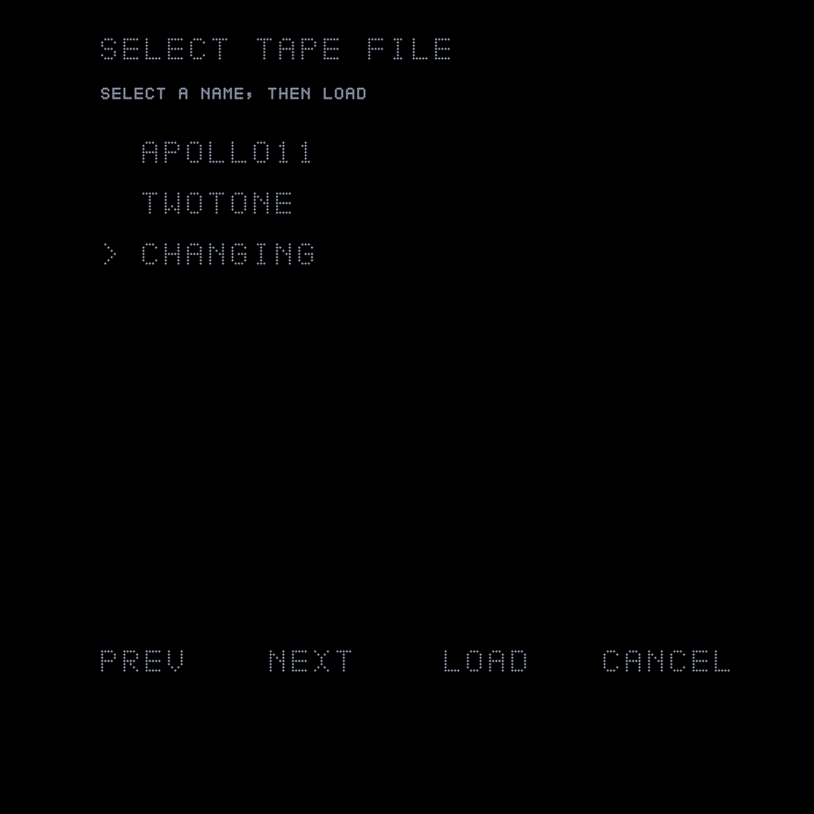

# On-screen Microtape file picker (v5)

Start in tape mode with `make run-tape`. The existing startup default still loads first. At the upper right of the T30dpy screen, **LOAD FILE** opens the directory of that same tape/drive. Use the viewer's **left mouse button** as the Type 340 light pen.

1. Click **LOAD FILE**. Analysis pauses while the directory is mounted/read.
2. Click a filename. A `>` marks the selection.
3. Release the mouse button for at least 250 ms, then click **LOAD**.
4. The loading scene remains visible while the PDP-1 reads/validates the recording. Analysis restarts at track 1, frame 0, with the current sense-switch settings.

Use **PREV** and **NEXT** for eight entries per page. They do nothing at the first/last page. A new page clears the selection. **CANCEL** returns to the previous recording/frame without altering its sample RAM, waveform, or calculated power. Sense Switch 1 may advance it again after returning. The mouse must hit the drawn letters; blank space around a label is not a target. A held/dragged pen does not repeat an action; release briefly between selections.

The filenames come from the actual tape directory (up to 31 entries, nine characters per name). They are not compiled into a menu. Every occupied entry is shown, including non-recording files. File loading enforces the same header, length, 11-second RAM limit, checksums, padding, and bounded transport retries as startup loading.

If loading fails, **LOAD FAILED - SELECT ANOTHER FILE** appears and you can select another file or retry. Once a load starts, Cancel is unavailable because RAM may already contain part of the failed recording. No FFT runs on that RAM until a complete replacement passes validation. Status retains the fault until the next attempt; successful loading clears it. A failure opening the directory before any load allows Cancel back to the old spectrum.

This picker selects files only on the currently configured tape/drive. It does not select/mount another host image, create files, format, or write a tape. The host assignment remains locked. Choosing a file does not change `generated/tape-config.json`; loading the binary again uses that configured startup default. A panel restart without reloading retains the in-memory filename. Startup failures still use the original error scene and require halting/correcting/reloading.

## Implementation

`picker.ac` runs in unused bank-0 space starting at octal 5000. Bank 1's 512-word drum-directory workspace becomes the modal display list only in tape mode. The ordinary bank-2 double buffers and bank-5–15 sample capacity remain unchanged.

The channel-0 ISR reads the pen coordinates/clock into a mailbox and resumes the beam with DRS. Only the main loop consumes presses or calls the filesystem. A 250-ms gap with no reported hit rearms selection, following the same principle as Bill's pen menus. The existing PENMENU library declares its rows at assembly time; this picker uses the underlying Type 340 pen mechanism directly to support dynamic nine-character names.

Before replacing any modal list or starting tape I/O, the main loop disables sequence breaks and stops the display. Directory mounting and loading use the paced autonomous loading scene. The modal picker uses HALT/completion interrupts, bounded list writes, and invisible positioning words to pace refresh. Pending requests are cleared **before** starting a pen-sensitive list. Cancel restarts the untouched analysis list; a successful load resets acquisition and constructs a new one.

Names are opened using their original SIXBIT codes converted to AM1 ASCII, including trailing directory padding. Rendering uses a separate Type 342 glyph table with an explicit character-set shift per glyph, so punctuation cannot change following letters. Native Type 342 character shapes apply.

`make -f Makefile.tests test-picker` runs a guest CPU/ISR interaction script with the real isolated Type 550 transport. It checks cancellation and preserved RAM, a runtime TWOTONE load and FFT oracle, held presses, next/previous pages across 11 entries, a nine-character name, invalid-file recovery, disabled Cancel after a failed load, and unchanged tape-image hashes. The scripted adapter models interrupt/coordinate/resume behavior; actual mouse geometry and rendering are checked on the live viewer separately.
