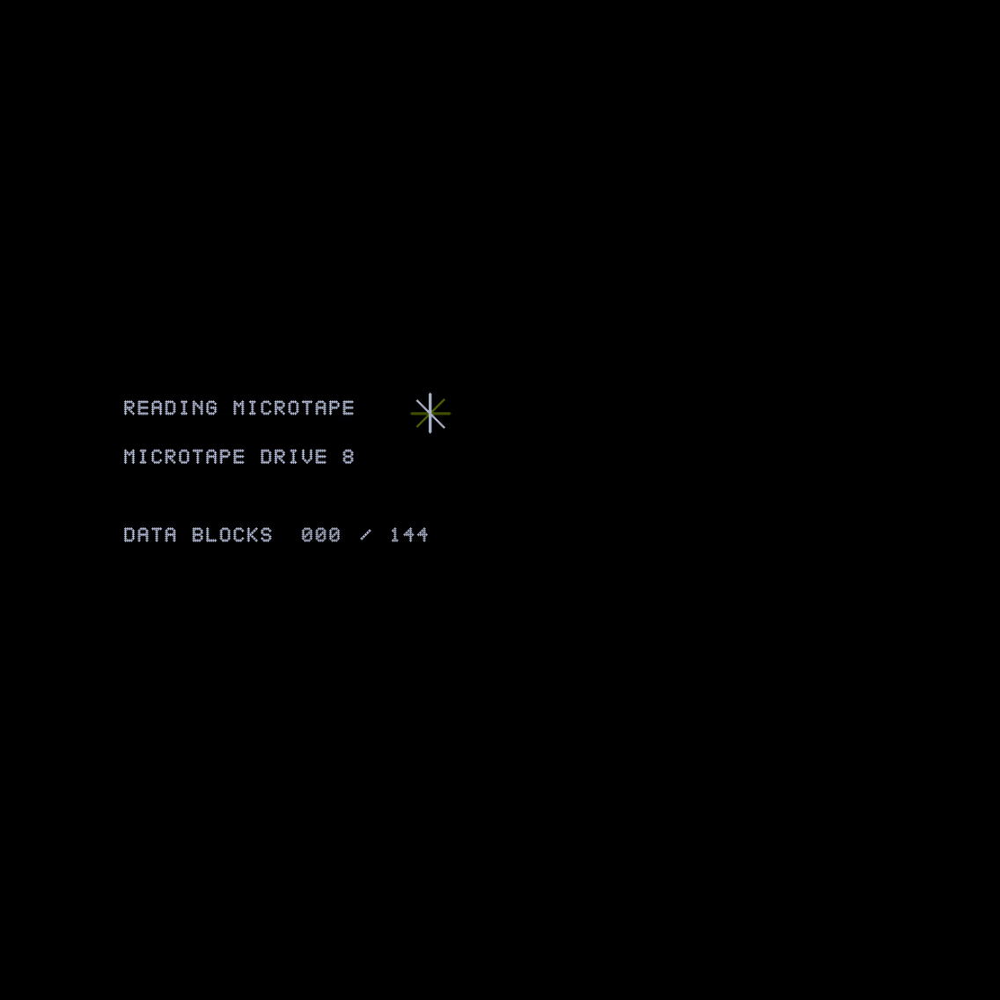

# Loading feedback (v6)

[Short clip of the live spinner](loading.mp4)

The tape-loading screen now has two independent indicators:

- A rotating vector line beside **READING MICROTAPE**. It continues moving while the PDP-1 is inside a blocking tape seek/read, with sequence breaks disabled.
- **DATA BLOCKS 000 / 144** for Apollo. The count advances by four after each complete, successful 1024-word read. The total comes from the validated recording header: 144 blocks for nine logical seconds, 16 for either supplied calibration, at most 176 for eleven seconds.

These are 256-word **payload** blocks. Tape directory blocks and the recording's header block are not counted. Until the header has been read and validated, the denominator is `---`. During directory/header seeks the line rotates while the count stays at zero. During a payload seek it rotates while the last completed count stays unchanged. Failed attempts/retries do not earn blocks. After all blocks are read, the program still validates the complete payload checksum and padding before analysis. No samples are copied to the drum.

The spinner is a display heartbeat, not proof that the tape or CPU is making forward progress. The counter is the indication of completed data transfers. Known errors switch to the existing error screen or return to the file picker; those error scenes do not pretend a load is continuing.

## How it works

`loading.ac` uses the spare space after the picker in bank 0. `generated/loading-animation.ac` is a Type 340 command chain with four line orientations. Each is refreshed twelve times, using the existing paced loading text. Nominal orientation dwell is about 149 ms, roughly a 0.6-second rotation; real timing depends on host/device load.

Each display SAVE enters an orientation routine. Its first DDS deposits the return jump and clears the save-active flag before drawing text (a Type 342 END could otherwise consume the saved return). The common loading scene draws the labels, counters, and unlit pacing commands, then jumps back through that deposited return. This repeats without CPU instructions, interrupt service, or changes to emulator code.

`loading_begin` resets the count for both directory mounting and recording loading. Once the header passes validation, the guest supplies the payload-block total. After each successful chunk, `loading_update` stops the display, updates the two three-digit fields, then restarts the autonomous chain. This avoids partially updated decimal text; a counter update also restarts the spinner's cycle. Counter conversion uses bounded subtraction, with private scratch. It does not change filesystem parameters, FFT arithmetic, sample capacity, tape assignments, or read-only behavior.

`make -f Makefile.tests test-loading` executes the assembled display stream with no CPU steps or interrupts, checking two complete rotations, SAVE/DDS return ownership, pacing and in-bounds coordinates. The real CPU/Type-550 tests trace completed counts through normal loading, recovered missed words and persistent failures; the full Apollo test checks 144/144. Mouse/display behavior is checked separately on the live Pi.
